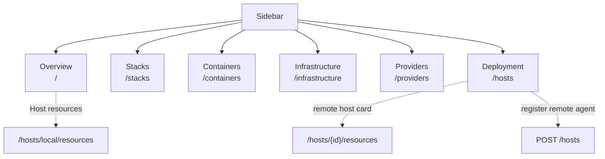
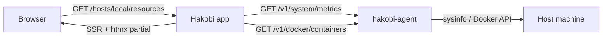

# Existing Hakobi

This is the single retained repository document. It records the current
application surface, the sidebar destinations, and the code entry points that
implement them.

## Runtime

```text
Rust + Axum 0.8 + Maud SSR
SQLite catalog
Native host agent (hakobi-agent)
DockerBackend plus AgentBackend
HTMX partial refresh
```

## Sidebar map



Important distinction:

- `Deployment` points to `/hosts` for remote-agent registration and management.
- `/hosts/local/resources` is opened from the overview, not from the Deployment
  tab.
- Remote host resources are opened from a remote host card.

Current active-state caveat: the host resources template calls
`sidebar("deployment", ...)` for both local and remote hosts. That makes the
Deployment item look selected while viewing `/hosts/local/resources`. The link
target is still `/hosts`; only the active state is wrong.

## Sidebar code

```rust
// src/web/templates.rs
fn nav_item(active: &str, key: &str, href: &str, icon: &str, label: &str) -> Markup {
    let class = if active == key {
        "relative flex items-center gap-3 rounded-lg bg-slate-100 px-3.5 py-2.5 text-sm font-semibold text-slate-900 no-underline before:absolute before:left-0 before:top-1/2 before:h-5 before:w-[3px] before:-translate-y-1/2 before:rounded-full before:bg-brand"
    } else {
        "flex items-center gap-3 rounded-lg px-3.5 py-2.5 text-sm font-semibold text-slate-500 no-underline transition hover:bg-slate-50 hover:text-slate-900"
    };
    html! {
        a class=(class) href=(href) aria-current=(if active == key { "page" } else { "false" }) {
            i class=(format!("fa-solid {icon} w-4 text-center")) aria-hidden="true" {}
            span { (label) }
        }
    }
}

fn sidebar(active: &str, base_url: &str, username: &str, csrf_token: &str) -> Markup {
    html! {
        aside class="fixed inset-y-0 left-0 z-40 hidden w-64 flex-col bg-white px-5 py-6 lg:flex" aria-label="Sidebar" {
            div class="px-1" { (brand("Hakobi dashboard")) }
            nav class="mt-9 flex flex-col gap-1" aria-label="Primary" {
                (nav_item(active, "overview", "/", "fa-square-poll-vertical", "Overview"))
                (nav_item(active, "stacks", "/stacks", "fa-layer-group", "Stacks"))
                (nav_item(active, "containers", "/containers", "fa-box", "Containers"))
                (nav_item(active, "infrastructure", "/infrastructure", "fa-server", "Infrastructure"))
                (nav_item(active, "providers", "/providers", "fa-plug", "Providers"))
                (nav_item(active, "deployment", "/hosts", "fa-rocket", "Deployment"))
            }
        }
        // Mobile uses the same six destinations with short labels.
    }
}
```

## HTTP route table

```rust
// src/web/mod.rs
Router::new()
    .route("/", get(handlers::dashboard))
    .route("/providers", get(handlers::providers).post(handlers::add_provider))
    .route("/providers/{id}/test", post(handlers::test_provider))
    .route("/providers/{id}/toggle", post(handlers::toggle_provider))
    .route("/providers/{id}/delete", post(handlers::delete_provider))
    .route("/containers", get(handlers::containers))
    .route("/containers/new", get(handlers::container_new).post(handlers::container_create))
    .route("/containers/{provider}/{name}/start", post(handlers::container_start))
    .route("/containers/{provider}/{name}/stop", post(handlers::container_stop))
    .route("/containers/{provider}/{name}/restart", post(handlers::container_restart))
    .route("/containers/{provider}/{name}/delete", post(handlers::container_delete))
    .route("/stacks", get(handlers::stacks))
    .route("/stacks/new", get(stacks_admin::stack_new).post(stacks_admin::stack_create))
    .route("/stacks/{id}/edit", get(stacks_admin::stack_edit).post(stacks_admin::stack_update))
    .route("/stacks/{id}/delete", post(stacks_admin::stack_delete))
    .route("/stacks/runtime/{provider}/{name}", get(handlers::stack_detail))
    .route("/infrastructure", get(handlers::infrastructure))
    .route("/hosts", get(handlers::hosts_list).post(handlers::hosts_create))
    .route("/hosts/{id}/resources", get(handlers::host_resources))
    .route("/hosts/{id}/resources/partial", get(handlers::host_resources_partial))
    .route("/hosts/{id}/test", post(handlers::hosts_test))
    .route("/hosts/{id}/toggle", post(handlers::hosts_toggle))
    .route("/hosts/{id}/delete", post(handlers::hosts_delete))
    .route("/host/install/{tool}", post(handlers::install_tool))
    .route("/partials/metrics", get(handlers::metrics_partial))
    .route("/partials/readiness", get(handlers::readiness_partial))
    .route("/login", get(handlers::login_page).post(handlers::login))
    .route("/logout", post(handlers::logout))
    .route("/healthz", get(|| async { "OK" }))
    .route("/partials/status", get(handlers::status))
    .route("/assets/{*path}", get(handlers::asset))
```

## Core functions

```rust
// src/web/handlers.rs
pub(super) async fn dashboard(State, HeaderMap, Query<ProviderNotice>) -> Response;
pub(super) async fn providers(State, HeaderMap) -> Response;
pub(super) async fn add_provider(State, HeaderMap, Form<ProviderForm>) -> Response;
pub(super) async fn containers(State, HeaderMap, Query<ProviderNotice>) -> Response;
pub(super) async fn container_create(State, HeaderMap, Form<ContainerForm>) -> Response;
pub(super) async fn stacks(State, HeaderMap, Query<ProviderNotice>) -> Response;
pub(super) async fn infrastructure(State, HeaderMap) -> Response;

pub(super) async fn hosts_list(State, HeaderMap) -> Response;
pub(super) async fn hosts_create(State, HeaderMap, Form<HostsCreateForm>) -> Response;
pub(super) async fn hosts_test(State, HeaderMap, Path<String>, Form<CsrfForm>) -> Response;
pub(super) async fn hosts_toggle(State, HeaderMap, Path<String>, Form<CsrfForm>) -> Response;
pub(super) async fn hosts_delete(State, HeaderMap, Path<String>, Form<CsrfForm>) -> Response;
pub(super) async fn host_resources(State, HeaderMap, Path<String>) -> Response;
pub(super) async fn host_resources_partial(State, HeaderMap, Path<String>) -> Response;

pub(super) async fn metrics_partial(State, HeaderMap) -> Response;
pub(super) async fn readiness_partial(State, HeaderMap) -> Response;
pub(super) async fn install_tool(State, HeaderMap, Path<String>, Form<CsrfForm>) -> Response;
```

```rust
// src/web/handlers.rs helpers
pub(super) async fn authenticated(&AppState, &HeaderMap) -> bool;
pub(super) async fn load_providers(&AppState) -> anyhow::Result<Vec<ProviderConnection>>;
pub(super) async fn with_catalog<T, F>(&AppState, F) -> anyhow::Result<T>;
```

## Provider and agent functions

```rust
// src/providers/agent.rs
impl ContainerBackend for AgentBackend { /* test, containers, snapshot, mutations, run */ }
impl ContainerBackend for RoutingBackend { /* dispatch agent:// or Docker */ }

// src/providers/agent.rs
pub fn ensure_local_provider(
    catalog: &mut Catalog,
    access: Option<LocalDockerAccess>,
) -> Result<Option<String>>;

// src/bin/hakobi-agent.rs
async fn readiness(...);
async fn docker_metrics(...);
async fn system_metrics(...);
async fn docker_containers(...);
async fn docker_snapshot(...);
async fn docker_run(...);
async fn container_action(...);
```

## Host resources flow



## Mandatory agent policy

All agent-authored output MUST be English: replies, plans, commit messages,
documentation, comments, and issue text. This overrides the prompt language. A
non-English response is a protocol violation and must be rewritten before
delivery.
