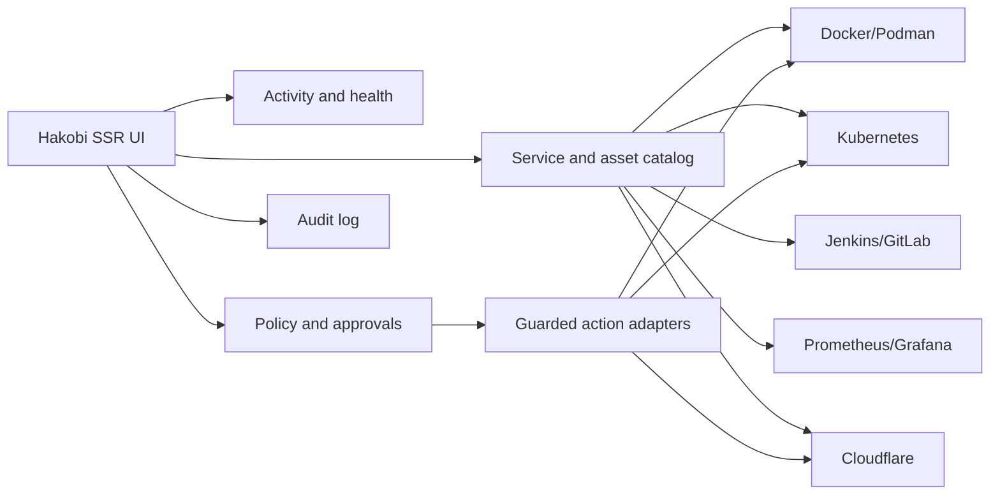

# Hakobi Integration Strategy and Opinion

Last verified: **2026-11-05**

## My opinion

Build Hakobi as an **operations graph and policy layer**, not as “Portainer with more tabs.”

The market already has:

- Container engines: Docker, Podman
- Local developer UX: OrbStack, Docker Desktop
- Runtime management: Portainer, Swarmpit
- Orchestration: Kubernetes
- CI: Jenkins, GitLab
- Observability: Prometheus, Grafana
- Edge compute and security: Cloudflare

Hakobi’s differentiation should be the connective tissue:

> One place that knows which service exists, who owns it, where it runs, what changed, whether it is healthy, and which guarded action is safe.

That is valuable across heterogeneous infrastructure. A faster container list is not.

## What not to build

- Another metrics time-series database
- A Grafana replacement
- A CI scheduler
- A container engine
- A reverse proxy for every provider dashboard
- A generic shell execution service
- Automatic permanent IP bans
- A universal YAML abstraction that hides provider capabilities
- Support for every platform at shallow parity

The last point matters. A Kubernetes Deployment, Docker service, Podman container, Jenkins job, and Cloudflare Worker are not the same object. Forcing them into one “app” model creates misleading behavior.

## Recommended product model



### Core entities

```text
Organization
Project
Environment
Service
Workload
  kind: container | compose_stack | swarm_service | k8s_workload |
        ci_runner | edge_worker | edge_pages | static_site
ProviderConnection
Runner
Job
Deployment
Observation
Alert
Policy
Decision
Incident
AuditEvent
```

`Workload` is the normalized identity. Provider details remain typed and visible rather than flattened into fake equivalence.

### Service discovery

Do not scan networks. Discover from provider APIs and explicit metadata:

- Docker labels and Compose project labels
- Kubernetes annotations, namespaces, and owner references
- GitLab project/runner scopes
- Jenkins job folders and labels
- Cloudflare routes and custom domains
- Manual ownership mappings

Auto-detection is a suggestion mechanism. A discovered resource is not trusted or manageable until an administrator confirms ownership/permissions.

## Provider priority

| Priority | Provider | Mode | Why |
|---|---|---|---|
| 1 | Docker Engine / Compose | Read-only, then controlled start/stop/deploy | Fastest path; existing user base |
| 2 | Podman REST | Read-only, then lifecycle | Rootless, Docker-compatible, common on Fedora |
| 2 | Jenkins + GitLab Runner | Read-only metrics/activity | High user value, low write risk |
| 2 | Prometheus + Grafana | Read-only queries/links | Context without duplicating telemetry |
| 3 | Kubernetes | Read-only, then controlled rollout | Large market, highest complexity |
| 3 | Cloudflare Workers/Pages | Read-only inventory, then deploy/rollback | Strategic edge provider |
| 4 | Guarded policy actions | Challenge/ban/scale/restart | Requires trust and audit |
| 5 | Workers for Platforms | Later / separate product | Multi-tenant customer code is a different business |

OrbStack is not a priority row. It is reached as a Docker endpoint on macOS.

## Delivery phases

### Phase 0 — Foundation

- Provider connection model and encrypted credential references
- Service catalog and ownership
- Activity/event schema with timestamps and freshness
- Audit log
- Read-only capability model
- Egress allowlisting and SSRF protection

### Phase 1 — Read-only operations view

- Docker/Podman containers and Compose stacks
- Jenkins/GitLab runner status and queue
- Prometheus targets/alerts and Grafana links
- Unified activity timeline
- Health states: healthy, degraded, stale, unknown

Do not add mutation in this phase.

### Phase 2 — Kubernetes and edge

- Kubernetes workloads, pods, jobs, events, rollout status
- kube-state-metrics/metrics-server integration
- Cloudflare Workers/Pages inventory and deployment history
- Service-to-dashboard-to-alert-to-runner mapping

### Phase 3 — Guarded actions

- Restart, scale, deploy, roll back
- Approval policies
- Dry-run and provider-side verification
- Bounded action windows and automatic timeout
- Full before/after evidence in audit

### Phase 4 — Response automation

- Bot/attack shadow decisions
- Challenge actions
- Short bans
- Reviewed long bans
- Incident creation and post-incident reporting

## Bot and abuse opinion

Do not build a proprietary bot detector. Use provider signals:

- Cloudflare bot/WAF/rate-limit events where the plan provides them
- CrowdSec decisions where deployed
- Application authentication anomalies as supporting evidence

The safe enforcement ladder:

```text
observe -> recommend -> challenge -> short ban -> review -> longer ban
```

Requirements:

- Shadow mode before action
- Short default TTL
- Explicit allowlist for administrators, CI, monitoring, and verified bots
- Ban cap and rate limit
- Global kill switch
- One-click reversal
- Immutable audit
- No permanent automatic bans

An IP is not a user. NAT, corporate proxies, CDNs, and cloud egress make IP bans blunt. Prefer challenge or scoped rate limits when uncertain.

## Security architecture

Hakobi would hold credentials that control infrastructure. Treat it as a privileged control plane.

### Credential handling

- Encrypt provider credentials at rest with a master key from OS secret storage or an external KMS.
- Keep credentials out of logs, traces, frontend state, and error messages.
- Use per-provider scopes and explicit read/write capabilities.
- Support rotation and revocation.
- Bind each action to an actor and provider credential.

### Network and execution

- Allowlist provider base URLs; do not accept arbitrary URLs per request.
- Verify TLS; permit private CAs only through explicit configuration.
- Never execute user-provided shell commands.
- Use typed clients for Docker, Kubernetes, Jenkins, GitLab, Cloudflare.
- Run provider workers outside the public web process.
- Apply least-privilege RBAC inside Hakobi.

### Host security

Mounting a Docker socket into a web container is root-equivalent access. If supported, use a broker or constrained agent with explicit API allowlists. Do not repeat Swarmpit’s socket exposure model in a multi-tenant product.

### Authorization

- Role-based access per organization/project/environment
- Separate `view`, `operate`, `admin`, and `approve` capabilities
- Approval separation for destructive actions
- Session re-authentication for bans, secret changes, and rollbacks
- Audit before/after state, not just “action succeeded”

## Scale concerns

- Poll provider APIs with jitter and per-provider budgets; do not stampede.
- Prefer provider webhooks/events where available, with polling as reconciliation.
- Cache short-lived summaries, not raw unbounded payloads.
- Normalize to stable IDs.
- Track collector health separately from workload health.
- Partition by organization/provider connection for future multi-tenancy.
- Bound JSON payloads and log retention.

## Business model opinion

Open-core fits this market only if the free product is genuinely useful. A credible split:

**Free/self-hosted**

- Read-only inventory
- Basic Docker/Podman/Kubernetes connectors
- Basic CI/observability links
- Community support

**Paid team/enterprise**

- SSO/SCIM and fine-grained RBAC
- Approval workflows and policy automation
- Audit retention/export
- Multi-tenant isolation
- High-availability deployment
- Supported connectors and upgrade guarantees

Avoid charging a markup on customer cloud usage. Sell control, compliance, and operational safety.

## Strong recommendation

Do not attempt the entire feature list in one implementation. Ship the **read-only operational graph** first:

1. Docker/Podman inventory
2. Runner activity
3. Prometheus/Grafana alert context
4. Kubernetes read-only
5. Cloudflare edge inventory
6. Guarded actions
7. Automated bot response

If the read-only graph is not useful, the action layer will not save the product.

## Sources

- See documents 01–05 for provider-specific citations.
- Hakobi architecture decision: this document, 2026-11-05.
