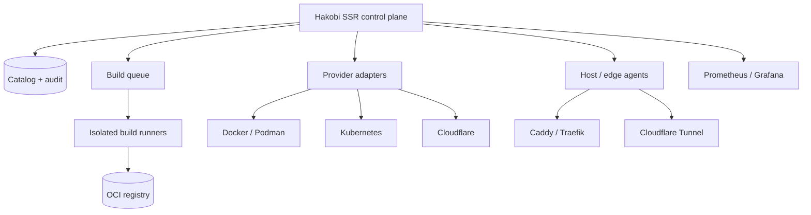

# Hakobi — Merged Product Requirements Document

**Version:** 0.3 Draft  
**Date:** November 5, 2026  
**Supersedes:** PRD v0.2 and the roadmap ordering in the R&D notes  
**Status:** Draft for review

## 1. Product vision

Hakobi is a self-hosted DevOps control plane that manages the application lifecycle from one operational surface:

- Connect existing infrastructure and discover running services.
- Build, test, package, and version applications.
- Deploy images to supported infrastructure providers.
- Attach domains and configure reverse-proxy routing.
- Monitor health, resource usage, deployments, and alerts.
- Scale through the provider’s native mechanism.
- Keep credentials, actions, and audit history under explicit control.

Hakobi integrates established technologies instead of replacing container runtimes, orchestrators, DNS, or observability systems.

## 2. Product principles

### Unified control plane

One interface covers infrastructure, applications, builds, releases, deployments, domains, observability, and operational activity.

### Provider independence

The service catalog is provider-neutral. Docker, Podman, Docker Swarm, Kubernetes, and Cloudflare Workers remain distinct workload types with explicit capabilities.

Provider independence does **not** mean pretending that every provider supports the same operations.

### Native application CI/CD

Hakobi owns the application pipeline: source event, isolated build, image artifact, deployment, and verification.

This is **not** a general-purpose CI farm and is not intended to replace Jenkins as an arbitrary automation platform. Hakobi pipelines exist to build and operate Hakobi-managed applications.

### Delegated execution

The control plane never executes untrusted repository code. Builds run in isolated runners. Container lifecycle and scaling use provider APIs. Traffic is delegated to a reverse proxy and Cloudflare.

### Security first

Credentials, build secrets, provider endpoints, authorization, and destructive actions have explicit trust boundaries.

### Incremental end-to-end delivery

Each checkpoint must produce a usable workflow. A broad read-only foundation comes before mutations, and a single complete lifecycle comes before ecosystem breadth.

## 3. Architecture

### 3.1 Control plane

Responsibilities:

- Authentication and authorization
- Organizations, projects, environments, and services
- Provider connections and capability scopes
- Pipeline definitions and build scheduling
- Deployment orchestration
- Domain and routing intent
- Health, freshness, and activity aggregation
- Audit events

The control plane must not:

- Run repository build steps in-process
- Implement its own container engine
- Store a second metrics time series
- Accept arbitrary shell commands from the UI
- Proxy arbitrary URLs

### 3.2 Build runner plane

Build runners are separately deployed workers that:

- Lease queued jobs
- Pull the requested source revision
- Execute in an isolated sandbox
- Produce an OCI image
- Push to a configured registry
- Report logs, status, and immutable image digest

The runner has no control-plane database access. Communication uses a scoped runner credential and short-lived job tokens.

### 3.3 Host and edge plane

Managed hosts may run a lightweight agent for:

- Provider connection over outbound mTLS/WebSocket
- Reverse-proxy configuration
- Cloudflare Tunnel routing
- Health reporting

An agent is optional when the control plane can reach the provider API directly. Running applications must not require exposing their container runtime socket to the browser or public network.

### 3.4 Data plane

- Persistent catalog and audit in SQLite initially
- PostgreSQL migration path for multi-instance deployments
- External OCI registry for artifacts
- Existing Prometheus/Grafana for telemetry by default
- Optional GreptimeDB for a Rust-native metrics/logs/traces backend
- No self-built time-series database
- Provider APIs as the source of runtime truth

### 3.5 Observability boundary

Hakobi owns observability **context and presentation**, not the telemetry database.

**Default mode:**
- OpenTelemetry instrumentation for Hakobi services and build runners
- Read-only Prometheus and Grafana connectors
- Alert-to-service mapping, freshness, and dashboard links
- Existing telemetry infrastructure remains authoritative

**Rust-native mode:**
- Optional GreptimeDB backend (Rust, Apache-2.0)
- Metrics, logs, and traces in one queryable backend
- PromQL API and SQL queries
- Hakobi renders its own Maud-based health, chart, and alert views
- PromQL compatibility must be tested against supported Hakobi queries

**External-provider mode:**
- OpenObserve may be connected as an external observability provider
- OpenObserve is AGPL-3.0; its code must not be embedded or modified for distribution without a license review
- Vector may be supported as an optional telemetry pipeline, not as a database

**Explicitly rejected:**
- Building a Prometheus-compatible time-series database
- Building a log/trace storage engine
- Reimplementing PromQL, retention, compaction, or high availability
- Bundling AGPL observability code into the core binary without review

## 4. Roles and tenancy

Initial deployment is single-organization, but data models must carry organization/project/environment identifiers from the beginning.

Roles added in the enterprise checkpoint:

- Viewer
- Operator
- Admin
- Approver

The initial single-user setup remains compatible with later organizations and RBAC.

## 5. Infrastructure and workload management

### 5.1 Initial providers

- Docker Engine
- Docker Compose
- Podman

OrbStack is supported through its Docker-compatible endpoint rather than as a separate provider.

### 5.2 Planned providers

- Docker Swarm
- Kubernetes
- Cloudflare Workers
- Cloudflare Pages

### 5.3 Discovery

Discover from provider APIs and explicit metadata:

- Hosts and runtime versions
- Containers and application services
- Compose projects and stacks
- Images, tags, digests, volumes, and networks
- Published ports and health checks
- Resource snapshots and restart counts
- Labels, annotations, and owner references
- Workload-to-host mapping

No network scanning. Discovery suggestions require ownership confirmation before a workload becomes manageable.

### 5.4 Scaling

Scaling remains a provider capability:

- Docker Swarm replicas
- Kubernetes replicas and rollout controls

Docker/Podman standalone containers may be restarted or recreated, but Hakobi must not simulate orchestration.

Initial release scope: visibility only. Mutations arrive in the safe-operations checkpoint.

## 6. Native CI/CD

### 6.1 Repository integrations

Initial providers:

- GitHub
- GitLab

Requirements:

- Scoped repository access tokens
- Webhook signature verification
- Delivery ID deduplication and replay protection
- Push, merge, and tag events
- Manual trigger
- Repository and commit links

### 6.2 Pipeline model

A pipeline supports these stages:

1. Source checkout
2. Dependency setup
3. Build
4. Tests
5. Container image build
6. Artifact push
7. Deployment
8. Post-deployment verification

Each stage has independent status, bounded logs, timeout, cancellation, and retry policy.

Initial pipeline configuration should be minimal and typed. It may begin with repository defaults plus a Hakobi pipeline file, but Hakobi must not introduce a universal YAML abstraction that hides provider behavior.

### 6.3 Build runners

Builds execute only in isolated runners:

- Rootless container build environment
- CPU, memory, process, and time limits
- Ephemeral workspace
- No host Docker socket
- Restricted egress
- Per-job secrets with short lifetime
- Log redaction
- Job cancellation
- Concurrent build limits
- Heartbeat and dead-runner detection
- Persistent queue and lease recovery

Proposed initial implementation: separate runner process using rootless BuildKit or rootless Podman, with build context isolation and an OCI push step. The final builder choice requires a technical spike.

### 6.4 Versioning

- Git commit SHA is always recorded.
- OCI image digest is the immutable deployment identity.
- Semantic versions may come from Git tags, commit history, or an explicit release form.
- Hakobi must not invent or overwrite a release version silently.
- Release uniqueness is enforced in the database.
- A mutable tag alone is never accepted as deployment identity.

### 6.5 Artifact management

- External OCI registry only
- Registry credentials scoped to organization/project
- Image metadata linked to source repository, commit, build, release, and digest
- Registry hosting is out of scope
- SBOM and provenance attestations are planned, not initial

### 6.6 Build history

Persist:

- Pipeline execution and stage results
- Duration and resource usage
- Commit, branch/tag, and release version
- Artifact digest
- Runner assignment
- Deployment target and outcome
- Links to source and provider systems
- Previous successful release

## 7. Deployment management

### 7.1 Initial deployment model

Docker Compose deployment to a connected Docker/Podman host.

### 7.2 Planned deployment models

- Docker Swarm service updates
- Kubernetes rollouts
- Cloudflare Workers/Pages deployments

### 7.3 Deployment workflow

1. Select service and image digest.
2. Select target environment.
3. Render the intended provider configuration.
4. Preview the diff and preflight checks.
5. Require authorization.
6. Execute through the typed provider adapter.
7. Verify provider-side state and application health.
8. Record the result and evidence.
9. Offer rollback to the previous successful digest.

Every mutation must be authorized, typed, auditable, idempotent, timeout-bounded, and verified.

## 8. Domains and traffic

### 8.1 Domain management

Cloudflare is the initial DNS provider.

Hakobi should:

- Attach a subdomain to a service
- Create/update DNS through the Cloudflare API
- Verify record ownership and conflicts
- Show propagation and TLS status
- Avoid overwriting unrelated DNS records
- Support rollback of Hakobi-created records

### 8.2 Reverse proxy providers

Supported initial design:

- **Caddy first**: simple configuration, automatic TLS, manageable reload path, low operational burden.
- **Traefik second**: strong Docker/Compose discovery and label-based routing.
- **Pingora excluded as a first-class provider**: it is a Rust proxy framework, not an out-of-box multi-tenant reverse proxy with a stable user-facing config API. It can be evaluated later as an implementation detail or advanced adapter.

Hakobi should preserve provider-specific capabilities rather than promise identical behavior.

### 8.3 Ingress modes

Two modes are supported in the design:

1. **Cloudflare Tunnel edge agent** — recommended for NAT, home labs, and hosts without public inbound ports.
2. **Public reverse-proxy IP** — Cloudflare proxied DNS points to the host or external proxy.

The first managed-app exposure implementation should choose one mode end-to-end. Recommended: a shared host-level tunnel agent per Docker host, with Caddy as the local router.

Per-application tunnel creation is deferred because it increases Cloudflare resource churn and lifecycle coupling.

### 8.4 Exposure workflow

1. Deploy an application.
2. Detect its service port.
3. Select or create a subdomain.
4. Select the ingress mode.
5. Render and validate proxy configuration.
6. Configure Cloudflare DNS.
7. Verify routing, TLS, and application reachability.
8. Record DNS/proxy ownership for rollback.

## 9. Unified service catalog

Each service records:

- Identity and ownership
- Organization, project, and environment
- Repository, commit, and release
- Build and artifact digest
- Deployment provider and environment
- Runtime and health status
- Ports and domains
- Resource usage
- Deployment and incident history
- Logs and external dashboard links
- Source and freshness for every external value

Statuses:

`healthy`, `degraded`, `stale`, `unknown`, `critical`

Unknown is not healthy. A stale collector must be visible.

### 9.1 Service topology map

Hakobi should provide a spatial graph of services and their evidence-backed relationships:

- Nodes: services, containers, databases, runners, routes, and workloads
- Edges: network adjacency, deployment, route, observed traffic, and manual dependency
- Health color and source freshness on every node
- Filter by environment, provider, health, and workload type
- Click a node to inspect details and open the provider resource
- Read-only list fallback for accessibility and large environments

The graph is generated from authorized catalog data. Hakobi must not display invented services or infer runtime dependencies from network adjacency without labeling the edge type.

Initial interaction is read-only with automatic layout. Pan, zoom, drag, persisted positions, minimap, and graph editing arrive later. Node labels are escaped; secrets and environment values never enter graph payloads.

## 10. Dashboard and UX

Main sections:

- Overview
- Infrastructure
- Services
- Topology
- Pipelines
- Builds and releases
- Deployments
- Domains and networking
- Monitoring and activity
- Provider connections
- Settings and audit

Core navigation and forms must work without client-side JavaScript. HTMX enhances specific interactions but is not required for authentication, deployment review, or authorization.

Provider errors, capability gaps, stale readings, and disabled actions must be explicit.

## 11. Security requirements

- Encrypt provider credentials and build secrets at rest.
- Keep credentials out of logs, traces, templates, URLs, and browser state.
- Allowlist provider endpoints and block link-local/metadata addresses.
- Verify TLS outside explicit private-CA configuration.
- Scope credentials per provider, organization, and capability.
- Execute builds only in isolated runners.
- Use short-lived, job-scoped build secrets.
- Record every mutation with actor, authorization, before/after state, and result.
- Require confirmation and re-authentication for destructive operations.
- No arbitrary shell interface from the web application.
- No raw runtime credentials in the browser.
- No arbitrary URL proxy.
- No permanent automatic abuse bans by default.
- Treat Docker sockets and kubeconfigs as privileged secrets.
- Separate read, operate, and approve capabilities.
- Make audit events append-only.

### Clarification: builds and “no shell”

Builds legitimately execute commands inside an isolated runner. “No arbitrary shell” means no web-user-supplied shell on the control plane or provider hosts. Pipeline commands are typed/structured, scoped to a build runner, and bounded by the pipeline definition.

## 12. Persistence and audit

- SQLite with migrations initially
- Stable IDs and foreign keys
- Organization/project/environment scoping from day one
- PostgreSQL support before high availability
- Encrypted credential envelope with key rotation
- Audit retention and export
- Backup/restore verification
- No secrets in database backups without encryption

## 13. Roadmap

### Checkpoint 1 — Persistent platform foundation

- SQLite catalog and migrations
- Organizations, projects, environments, services
- Typed provider connections
- Encrypted credentials and capability scopes
- Health/freshness tracking
- Immutable audit events
- SSRF-safe connection handling

**Gate:** provider connections can be created, tested, disabled, and removed without exposing credentials.

### Checkpoint 2 — Docker and Podman visibility

- Docker and Podman connections
- Compose discovery
- Host, container, image, volume, network, and port inventory
- Resource snapshots and restart counts
- Swarm visibility (read-only)
- Service ownership
- Bounded logs
- Read-only dashboard
- Read-only topology graph
- Network and route edge evidence
- List fallback for topology

**Gate:** all workloads on a connected host are visible with source, freshness, and ownership; the topology uses only real discovered nodes and evidence-backed edges.

### Checkpoint 3 — Native CI/CD foundation

- GitHub and GitLab repository connections
- Signed webhooks and event deduplication
- Pipeline definitions and stage status
- Isolated runner registration and queue
- Build execution, cancellation, and logs
- OCI image build and push
- Release/version tracking
- Build history
- Registry credentials
- Build security boundary tests

**Gate:** a signed repository event produces an isolated build and immutable image digest without executing code in the control plane.

### Checkpoint 4 — Deployment and domain management

- Compose deployment
- Preview and preflight checks
- Provider-side verification
- Deployment history
- Rollback by digest
- Cloudflare DNS integration
- One reverse-proxy backend (Caddy recommended)
- One end-to-end ingress mode
- Reachability and TLS verification
- DNS/proxy rollback

**Gate:** a built image can be deployed, exposed on a subdomain, verified, and rolled back.

### Checkpoint 5 — Observability and operational context

#### Integration mode

- OpenTelemetry instrumentation for Hakobi and runners
- Prometheus connection
- Grafana connection
- Target and alert state
- Service health mapping
- Collector health
- Deployment-to-error correlation
- Observed service-to-service edges from traces
- Dashboard links

#### Rust-native mode

- GreptimeDB connection and health check
- PromQL query adapter
- SQL query adapter for logs and traces
- Service health and freshness mapping
- Server-rendered metric summaries and SVG charts
- Bounded log and trace views
- Retention/downsampling configuration
- Query compatibility test suite
- Optional external Grafana/OpenObserve links

#### Provider integration

- External OpenObserve connector with license review
- Optional Vector pipeline support
- No telemetry database embedded in the control-plane process

**Gate:** the integration mode and the optional GreptimeDB mode both map health and alerts to services; representative PromQL queries pass compatibility tests; every value has source and freshness; no self-built time-series engine exists.

### Checkpoint 6 — Kubernetes visibility

- Cluster connection and namespaces
- Workloads, pods, jobs, services, and ingress
- Readiness and restart state
- Events and warnings
- Rollout status
- Read-only manifests
- `kube-state-metrics` and `metrics-server`

**Gate:** cluster state appears in the unified catalog without write permissions.

### Checkpoint 7 — Safe operations and scaling

- Docker Swarm service operations
- Kubernetes restart/scale/rollout
- Approval policy
- Re-authentication
- Idempotency keys
- Timeout and provider verification
- Automatic rollback on failed verification
- Audit evidence

**Gate:** every mutation is typed, authorized, idempotent, and verified.

### Checkpoint 8 — Cloudflare Workers and Pages

- Worker and Pages inventory
- Deployment history
- Routes and domains
- Usage and error summaries
- Logs and issues links
- Wrangler-aware build support
- Workers for Platforms inventory

**Gate:** edge workloads appear as a distinct workload type with deployments and health.

### Checkpoint 9 — Enterprise controls

- Multiple users and RBAC
- OIDC/SAML/SCIM
- API tokens
- Tenant isolation
- Backup/restore
- PostgreSQL and high availability
- Audit export

**Gate:** tenant isolation verified across UI, API, caches, webhooks, and audit.

### Checkpoint 10 — Ecosystem and scale

- External Jenkins/GitLab Runner observability
- Additional repository and CI providers
- Additional observability providers
- Notifications and incident management
- Connector SDK
- Public API and CLI
- Private-network agents
- Offline deployment

### Checkpoint 11 — Abuse response

- Cloudflare bot/WAF/rate-limit signals
- CrowdSec decisions where deployed
- Shadow mode and evidence
- Challenge actions
- Short TTL bans
- Allowlists, caps, kill switch, rollback
- Never permanent auto-ban by default

**Gate:** shadow mode demonstrates zero unexpected blocks before enforcement is enabled.

## 14. Release slices

The PRD’s 12-step acceptance flow is a complete lifecycle test, not the first release boundary.

### Slice A — Inventory

Checkpoints 1–2. Connect a Docker/Podman host and display the service catalog read-only.

### Slice B — Build

Checkpoint 3. A signed webhook builds a container image and records an immutable digest.

### Slice C — Deploy and expose

Checkpoint 4. Deploy that digest, attach a subdomain, route traffic, verify health, and roll back.

### Slice D — Complete lifecycle

The original 12-step acceptance flow after Checkpoint 4:

1. Connect Docker.
2. Discover Compose.
3. Connect GitHub/GitLab.
4. Configure a pipeline.
5. Trigger via webhook.
6. Build and tag an image.
7. Deploy to Docker.
8. Attach Cloudflare DNS.
9. Route through the selected proxy.
10. Verify health and reachability.
11. Show build/release/deployment history.
12. Demonstrate credential and secret protection.

The phrase “first useful release” in PRD v0.2 is replaced by **Slice A**. The 12-step flow is the **first complete-lifecycle release**.

## 15. Explicit non-goals

- Container engine implementation
- Container registry hosting
- Prometheus-compatible time-series database
- Grafana replacement
- Kubernetes replacement
- General-purpose CI/build farm
- Jenkins replacement as a standalone automation product
- Proprietary bot fingerprinting
- Permanent automatic bans by default
- Raw shell/`docker exec`/`kubectl exec` interface in the control plane
- Universal configuration hiding provider-specific behavior
- Per-container hosting resale as the core business
- Pingora as an initial reverse-proxy provider

## 16. Success metrics

Product:

- Applications built, deployed, exposed, and monitored end-to-end
- Time from repository event to reachable deployment
- Percentage of services with ownership and health evidence
- Failed deployment recovery time
- Stale collector rate

Reliability and security:

- Credential exposure incidents: zero
- Unauthorized mutation rate: zero
- Audit completeness for mutations
- Build isolation failures: zero
- Deployment rollback success rate
- False-positive abuse actions

Commercial:

- Active applications under management
- Connected providers per organization
- Retention after first successful deployment

## 17. Changes from PRD v0.2

1. Native CI/CD retained, but bounded to Hakobi application pipelines.
2. Build runner isolation and secret boundaries specified.
3. “First useful release” redefined as read-only inventory; 12-step flow is the complete lifecycle target.
4. Caddy selected as initial proxy; Traefik second.
5. Pingora reclassified as a framework, not a selectable provider.
6. Ingress modes made explicit; shared Cloudflare Tunnel edge agent recommended.
7. Abuse response retained as a later checkpoint rather than dropped.
8. External Jenkins/GitLab Runner observation moved to ecosystem scope.
9. “No shell” clarified for build execution.
10. Versioning uses image digest as immutable identity.
11. SBOM/provenance explicitly deferred.
12. Tenant fields added from the first persistence schema.
13. Observability UI remains Hakobi-owned; telemetry storage uses existing providers or optional GreptimeDB.
14. No custom time-series engine or embedded AGPL observability platform.
15. Added an evidence-backed read-only service topology map, with interactive canvas and observed edges phased later.

## 18. Open technical decisions

- Builder runtime: rootless BuildKit vs rootless Podman.
- Shared host agent packaging and transport: mTLS WebSocket vs SSH-managed.
- Reverse proxy configuration ownership: agent-generated Caddy config vs central config with signed delivery.
- First registry integration: GHCR, Docker Hub, or generic OCI.
- SQLite threshold for moving to PostgreSQL.
- GreptimeDB lifecycle in Rust-native mode: Hakobi-managed sidecar/service or externally managed endpoint.
- Whether OpenObserve is supported only as deep-link/API integration or as a richer optional provider.

## 19. Related research

- [Feature catalog and build checkpoints](./07-feature-catalog-and-checkpoints.md)
- [Container platform landscape](./01-container-platform-landscape.md)
- [CI and orchestration activity](./02-ci-and-orchestration-activity.md)
- [Observability stack](./03-observability-stack.md)
- [Bot detection and automatic banning](./04-bot-detection-and-auto-ban.md)
- [Cloudflare Workers, Pages, and Wrangler](./05-cloudflare-workers-pages-wrangler.md)
- [Integration strategy](./06-hakobi-integration-strategy.md)
- [Rust observability decision](./09-rust-observability-decision.md)
- [Service topology UI](./10-service-topology-ui.md)
