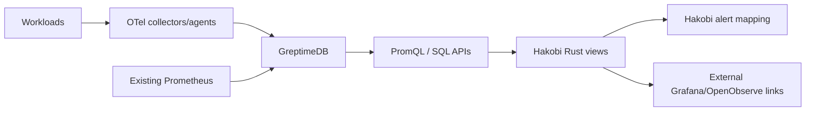

# Rust Observability Decision

Last updated: **2026-11-05**  
Status: **Proposed**

## Question

If Hakobi needs observability, should it:

1. Integrate Prometheus/Grafana, or
2. Use a Rust-based observability platform, or
3. Build its own observability backend?

## Decision

**Do not build a metrics/log database or query engine.**

Use a layered approach:

1. **Immediate:** OpenTelemetry instrumentation plus read-only Prometheus/Grafana connectors.
2. **Rust-native option:** use **GreptimeDB** as the storage/query backend and build Hakobi’s observability views in Maud/Rust.
3. **Optional external provider:** support **OpenObserve** as a connector, not as vendored code.
4. **Optional pipeline:** use **Vector** only if telemetry collection/routing needs a dedicated agent.

Hakobi owns the **service context, health model, alert mapping, and UI**. It does not own the telemetry database.

## Why not build observability from scratch?

A metrics/log backend requires:

- Columnar storage and compression
- Time-series indexing and cardinality control
- PromQL/SQL-compatible query engine
- Retention and downsampling
- Compaction and crash recovery
- High availability and replication
- Log/trace storage and search
- Alert evaluation and notification
- Backup and migration tooling
- Compatibility with existing Prometheus exporters

That is a multi-year infrastructure product, not a dashboard feature.

Building the UI and operational model is justified. Building the storage engine is not.

## Option comparison

| Option | Language | License | Strengths | Limitations |
|---|---|---|---|---|
| Prometheus + Grafana | Go + TypeScript | Open source/AGPL for Grafana OSS; commercial Cloud | Mature, ecosystem standard, alerting, dashboards | Not Rust; multiple services |
| GreptimeDB | Rust | Apache-2.0 | Metrics/logs/traces, PromQL + SQL, object storage, standalone binary | PromQL compatibility gaps; limited built-in product UI/alerts |
| OpenObserve | Rust backend + TypeScript UI | AGPL-3.0 | All-in-one logs/metrics/traces, PromQL/SQL, dashboards, alerts, incidents | AGPL obligations; separate UI; large surface |
| Parseable | Rust | AGPL-3.0 | Logs/metrics/traces, OTel, PromQL/SQL | Smaller ecosystem; AGPL; less proven |
| Vector | Rust | MPL-2.0 | Excellent collection/routing pipeline | Not a storage/query/dashboard backend; metrics/traces maturity varies |

## Why GreptimeDB is the best fit for a Rust-native Hakobi

GreptimeDB is:

- Written in Rust
- Apache-2.0 licensed
- One engine for metrics, logs, and traces
- Compatible with Prometheus Remote Write and PromQL
- Also queryable with SQL
- Deployable as a single binary or distributed cluster
- Able to use object storage for long-term data
- Available with retention, downsampling, and continuous aggregation

Most importantly, it preserves existing Prometheus/OTel ingestion while allowing Hakobi to own the presentation layer.

### Compatibility caution

GreptimeDB is not 100% PromQL-compatible. Its own v1.3 compatibility report shows gaps depending on metric-name handling and specific functions. Do not promise “drop-in Prometheus replacement” without testing the queries Hakobi depends on.

## Why not embed OpenObserve initially

OpenObserve is an excellent Rust-backed all-in-one observability product, but:

- It is **AGPL-3.0** licensed. Embedding or modifying it in a distributed product requires legal review.
- It ships its own TypeScript UI and product model, which competes with “one Hakobi dashboard.”
- It is a large additional service to operate and secure.
- A connector/deep-link integration gets most of the value without license coupling.

If users want a turnkey log/metrics/trace UI, support OpenObserve as an external provider. Do not copy its code into Hakobi.

## Recommended architecture

### Hakobi responsibilities

- Instrument itself with OpenTelemetry
- Ingest OpenTelemetry/Prometheus signals into a configurable backend
- Query metrics with PromQL
- Query logs/traces with SQL
- Associate signals with services, deployments, and runners
- Render bounded charts and alert state in Maud
- Keep links to full Grafana/OpenObserve experiences
- Store only short-lived summaries in the catalog database

### Provider responsibilities

- Store telemetry
- Retention/downsampling
- Query execution
- HA/replication
- Large log/trace exploration

## UI recommendation

For the first Rust-native observability UI:

- Server-rendered metric cards and SVG charts
- Query-backed tables
- Alert list and freshness indicators
- Deep links to richer external tools
- No custom time-series query editor initially

Do not build a full log explorer, trace waterfall, or PromQL IDE in the first observability phase.

## Phase plan

### Phase O1 — Integrate

- OpenTelemetry instrumentation for Hakobi services
- Prometheus/Grafana read-only connectors
- Alert mapping and service health
- No new telemetry database

### Phase O2 — Rust-native backend option

- GreptimeDB connection
- PromQL query adapter
- Basic metrics charts
- Service/deployment correlation
- Retention configuration

### Phase O3 — Logs and traces

- OTel log/trace ingestion
- SQL-backed log search
- Trace context links
- Bounded retention

### Phase O4 — Advanced

- Alert rule evaluation
- Anomaly detection
- Long-term object storage
- OpenObserve connector
- HA backend deployment

## Final opinion

If “Rust-based” is a hard product requirement, **choose GreptimeDB and keep the UI in Hakobi**. Do not build the observability database.

If speed and maturity matter more than language purity, **keep Prometheus/Grafana integration first**. The user cares about operational clarity, not the implementation language of the metrics store.

## Sources

- GreptimeDB repository: <https://github.com/GreptimeTeam/greptimedb>
- GreptimeDB PromQL: <https://docs.greptime.com/user-guide/query-data/promql>
- GreptimeDB OTLP: <https://docs.greptime.com/user-guide/ingest-data/for-observability/opentelemetry>
- OpenObserve repository: <https://github.com/openobserve/openobserve>
- OpenObserve metrics: <https://openobserve.ai/docs/features/metrics.md>
- Parseable repository: <https://github.com/parseablehq/parseable>
- Vector repository: <https://github.com/vectordotdev/vector>
- Prometheus overview: <https://prometheus.io/docs/introduction/overview/>
